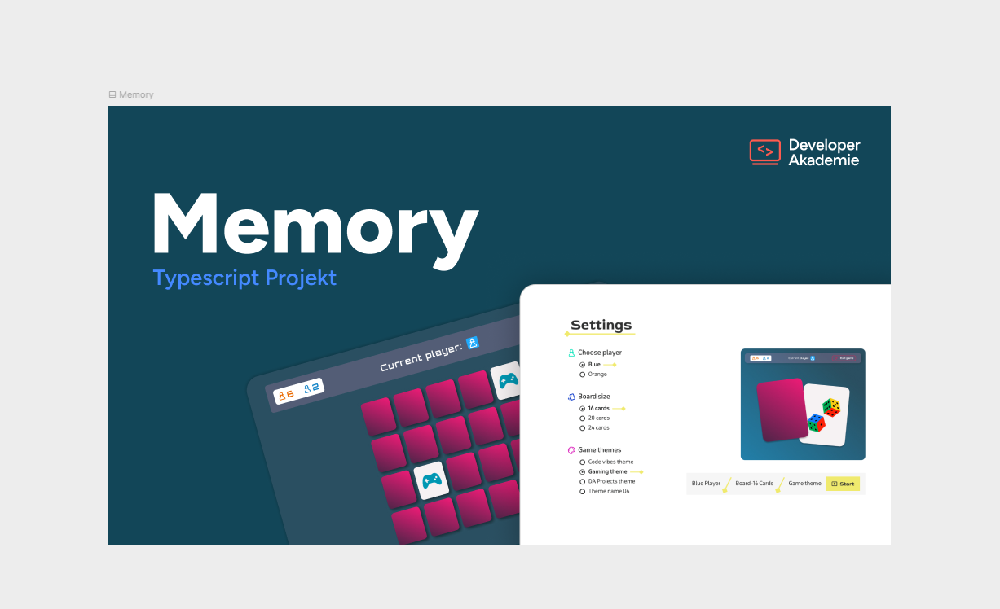
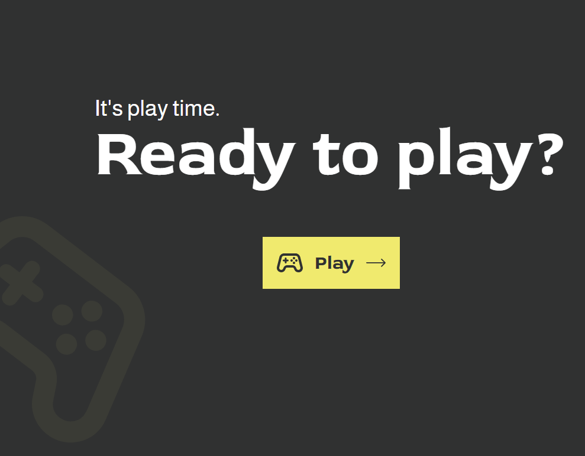
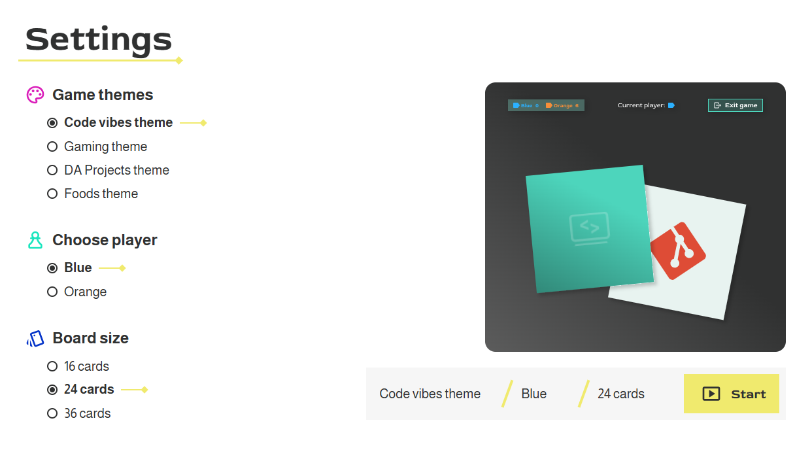
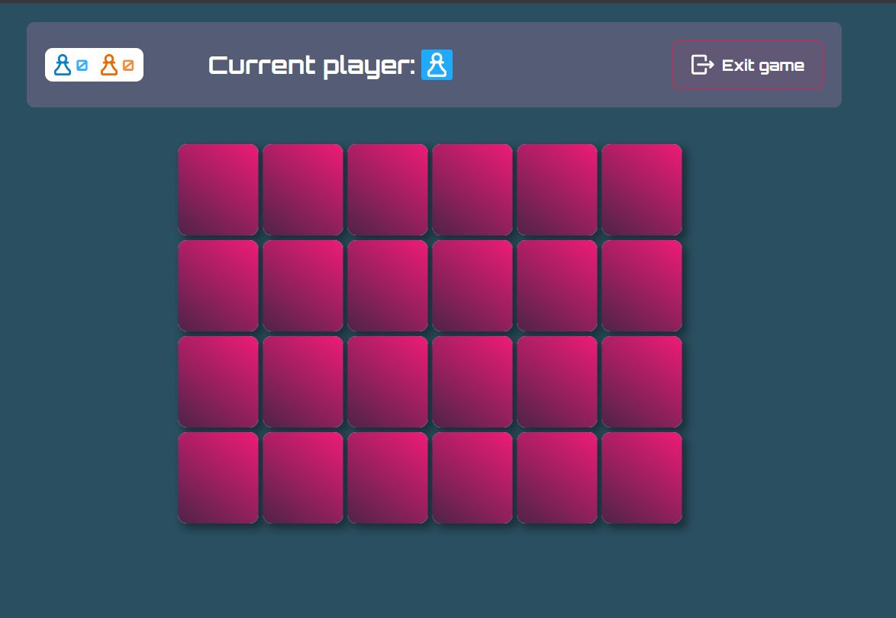
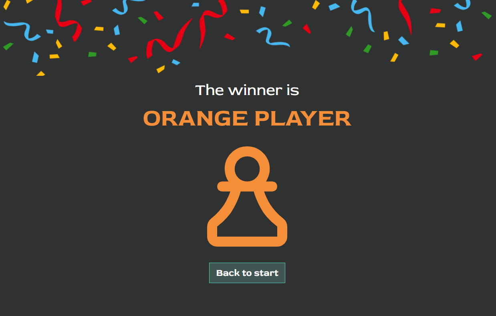

# Memory



A two-player memory card game built with TypeScript and SCSS. Choose a theme, pick your color and board size, and find more pairs than your opponent.

**Live demo:** https://georgios-vavitsas.developerakademie.net/Memory/

## Screenshots

| Home | Settings |
| --- | --- |
|  |  |

| Game | Result |
| --- | --- |
|  |  |

## Features

- Two players (blue and orange) take turns on one device
- Three board sizes: 16, 24 or 36 cards
- Four themes with their own colors, fonts, icons and card designs:
  Code vibes, Gaming, DA Projects and Foods
- Live theme preview while hovering over the theme options
- Animated card flips, exit dialog and confetti for the winner
- Game over screen with final score, winner and draw detection
- Responsive from 320px up to widescreen (1440px+)

## Tech Stack

- TypeScript
- SCSS (BEM naming, CSS custom properties for themes)
- Vite

## Getting Started

You need [Node.js](https://nodejs.org/) (LTS) installed.

```bash
git clone https://github.com/JiorgoV/Memory
cd Memory
npm install
npm run dev
```

Then open the address shown in the terminal, e.g. `http://localhost:5173/Memory/`.

### Build for production

```bash
npm run build
```

The finished files are created in the `dist` folder. Upload the **contents** of `dist` to your web server.
The base path is set to `/Memory/` in `vite.config.ts`. Change it if you host the game in a different folder.

## Project Structure

```
public/          static files: images, icons, fonts, favicon
src/
  main.ts        game flow, screen rendering and event handling
  game.ts        card creation and shuffling
  types.ts       shared TypeScript types
  templates/     HTML templates for each screen
  styles/        SCSS partials, one per screen, plus themes and fonts
```

## Credits

Design provided by the Developer Akademie (Figma template).